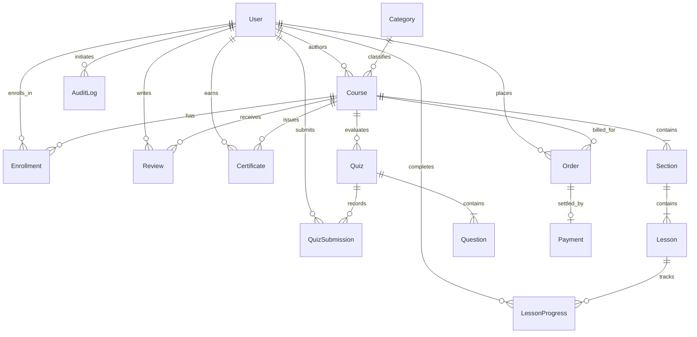

# SkillNova Academy — Database Architecture & Reliability Specification
**BS Computer Science Final Year Project (FYP)**

---

## 1. Executive Summary & Relational Integrity

The **SkillNova Academy** database is architected using **Prisma ORM** with **Third Normal Form (3NF)** compliance and strict relational integrity constraints. 

The schema powers an end-to-end learning lifecycle for students, instructors, and system administrators, featuring automatic course progress recalculation, dynamic quiz scoring, cryptographic certificate issuance, and sanitized audit logging.

---

## 2. Relational Schema Model (13 Core Entities)

| Table Name | Description | Key Attributes & Relational Constraints |
| :--- | :--- | :--- |
| **`User`** | Platform actors across all roles (RBAC: `STUDENT`, `TRAINER`, `ADMIN`). | Primary Key: `id` (UUID), `email` (Unique), `passwordHash` (Bcrypt), `role`, `phone`, `avatar`, `headline`, `bio`. Indexes on `role`, `createdAt`. |
| **`Category`** | Academic disciplines and course tracks. | Primary Key: `id`, `name` (Unique), `slug` (Unique), `icon`. |
| **`Course`** | Published & draft curricula with PKR fees. | Foreign Keys: `instructorId -> User.id`, `categoryId -> Category.id`. Cascade deletion. Indexes on `instructorId`, `categoryId`, `published`, `featured`, compound `[published, createdAt]`. |
| **`Section`** | Curriculum modules within courses. | Foreign Key: `courseId -> Course.id` (Cascade). Integer `order`. Compound index on `[courseId, order]`. |
| **`Lesson`** | Individual lecture units (video, notes, duration). | Foreign Key: `sectionId -> Section.id` (Cascade). `isFree` preview flag. Compound index on `[sectionId, order]`. |
| **`Enrollment`** | Student course registration & progress. | Compound Unique Key: `[userId, courseId]`. Dynamic float progress (0.0 to 100.0%). Indexes on `userId`, `courseId`, `progress`, compound `[userId, updatedAt]`, `[userId, progress]`. |
| **`LessonProgress`** | Granular per-lesson completion records. | Compound Unique Key: `[userId, lessonId]`. Boolean `isCompleted`, timestamp. Compound index on `[userId, isCompleted, completedAt]`. |
| **`Quiz`** | Course assessments with passing threshold. | Foreign Key: `courseId -> Course.id` (Cascade). `passingScore` (e.g. 70%). Index on `courseId`. |
| **`Question`** | Multiple-choice questions with answers & explanations. | Foreign Key: `quizId -> Quiz.id` (Cascade). JSON stringified options array. Index on `quizId`. |
| **`QuizSubmission`**| Student assessment attempts & score logs. | Foreign Keys: `quizId -> Quiz.id`, `userId -> User.id`. Compound indexes on `[userId, createdAt]`, `[quizId, createdAt]`. |
| **`Review`** | Course feedback, ratings, and testimonials. | Compound Unique Key: `[userId, courseId]`. 1 to 5 star rating, comment. Index on `[courseId, createdAt]`. |
| **`Certificate`** | Cryptographically verified credentials with assessment grades and revocation states. | Compound Unique Key: `[userId, courseId]`. Unique `certificateCode` (e.g. `SN-2026-A8F2-7E91-C4B3`), `grade` (Float? verified assessment score), `isRevoked` (Boolean), `revokedReason` (String?), `revokedAt` (DateTime?). Indexes on `userId`, `courseId`, `issuedAt`, compound `[userId, issuedAt]`, and `isRevoked`. |
| **`AuditLog`** | Operational governance & administrative mutation traces. | Primary Key: `id` (UUID), `action`, `entity`, `entityId`, `details` (sanitized JSON without secrets), `userId`, `ipAddress`, `createdAt`. Indexes on `[entity, entityId]`, `userId`, compound `[action, createdAt]`. |
| **`LessonResource`** | Protected supplementary downloads & materials. | Foreign Key: `lessonId -> Lesson.id` (Cascade). Title, filename, local fileUrl, fileSize, MIME fileType. Index on `lessonId`. |
| **`Assignment`** | Capstone course projects with deadlines & rubrics. | Foreign Key: `courseId -> Course.id` (Cascade). Title, description, maxScore, optional dueDate. Indexes on `courseId`, `createdAt`. |
| **`AssignmentSubmission`** | Student project deliverables & faculty evaluation. | Compound Unique Key: `[assignmentId, userId]`. Solution writeup, uploaded attachment, score, faculty feedback, status (`SUBMITTED`, `GRADED`, `RESUBMIT_REQUESTED`). Indexes on `assignmentId`, `userId`, `status`. |
| **`LessonDiscussion`** | Lesson-level academic inquiry & faculty answers. | Foreign Keys: `lessonId -> Lesson.id`, `userId -> User.id`. Content, `isAnswer`, `reported` moderation flag. Indexes on `[lessonId, createdAt]`, `userId`, `reported`. |
| **`Order`** | Financial checkout intents, canonical course pricing, and idempotency tracking. | Primary Key: `id` (UUID), Unique `orderNumber` (e.g. `ORD-2026-X7Y8Z`), Unique `idempotencyKey`, `amount` (Float), `currency` (`PKR`), `status` (`PENDING`, `COMPLETED`, `FAILED`, `CANCELLED`), `provider` (`DEMO_SANDBOX`). Foreign Keys: `userId -> User.id`, `courseId -> Course.id`. Compound indexes on `[userId, status]`, `[courseId, status]`. |
| **`Payment`** | Atomic transaction reconciliation ledger and gateway callback proof. | Primary Key: `id` (UUID), Unique `orderId -> Order.id`, Unique `providerTxnId` (e.g. `TXN-DEMO-9K2L1`), `amount`, `currency`, `status` (`PENDING`, `SUCCESS`, `FAILED`, `REFUNDED`), `paymentMethod` (`DEMO_CARD`, `DEMO_WALLET`, `WEBHOOK_CALLBACK`), sanitized `metadata` JSON (PCI-DSS compliant: zero card numbers or CVVs). Index on `status`. |

---

## 3. Entity-Relationship Diagram (ERD)



---

## 4. Query-Aligned Indexing Matrix

The indexing strategy directly mirrors application query patterns across Server Components and Server Actions:

| Model | Index Definition | Target Query Pattern / Application Path | Performance Rationale |
| :--- | :--- | :--- | :--- |
| **`Course`** | `@@index([published, createdAt])` | `/courses` (Catalog search, filtering, and sorting) | Eliminates filesort when filtering published courses ordered by newest first. |
| **`Course`** | `@@index([instructorId])` | `/dashboard/trainer` & `/dashboard/trainer/courses` | Fast retrieval of faculty-authored courses. |
| **`Section`** | `@@index([courseId, order])` | `/courses/[slug]` & Classroom syllabus rendering | Instant index-scan ordering of curriculum sections without in-memory sort. |
| **`Lesson`** | `@@index([sectionId, order])` | Classroom lesson sidebar & sequential navigation | Rapid sequential lookup of lessons belonging to a section. |
| **`Enrollment`**| `@@index([userId, updatedAt])` | `/dashboard/student` & `/dashboard/student/courses` | Fast ordering of active student enrollments by most recent activity. |
| **`Enrollment`**| `@@index([userId, progress])` | Student dashboard in-progress vs completed widgets | Quick partitioning of completed courses (`progress == 100`) vs active learning. |
| **`LessonProgress`** | `@@index([userId, isCompleted, completedAt])` | `getStudentAnalytics()` (Weekly activity telemetry) | Zero-table-scan aggregation for past 7 days learning streak calculation. |
| **`QuizSubmission`** | `@@index([userId, createdAt])` | `/dashboard/student/quizzes` (Student submission history) | Direct descending sort of student quiz attempts. |
| **`QuizSubmission`** | `@@index([quizId, createdAt])` | `/dashboard/trainer/assessments` (Trainer gradebook) | Rapid resolution of recent student attempts per assessment. |
| **`Review`** | `@@index([courseId, createdAt])` | `/courses/[slug]` (Course testimonials & reviews) | Accelerated course page load by fetching reviews chronologically. |
| **`Certificate`** | `@@index([userId, issuedAt])` | `/dashboard/student/certificates` | Instant chronological loading of student credentials. |
| **`Certificate`** | `@unique certificateCode` | `/verify?code=...` (Public verification portal) | $O(1)$ constant-time B-tree index lookup for credential validation. |
| **`AuditLog`** | `@@index([action, createdAt])` | Security review & administrative audit dashboard | Chronological lookup of governance events filtered by mutation action. |
| **`Order`** | `@@index([userId, status])` | `/checkout/[slug]`, user order history | Fast retrieval of active/pending orders per student to prevent redundant order creation. |
| **`Order`** | `@@index([courseId, status])` | Faculty financial breakdown, course revenue | Aggregates completed vs pending course sales. |
| **`Order`** | `@unique idempotencyKey` | Checkout order creation & payment gateway call | Blocks duplicate order injection on double-click or network retry. |
| **`Payment`** | `@unique providerTxnId` | `/api/webhooks/demo-payment` & payment settlement | Guarantees exactly-once processing of gateway transaction webhooks. |

---

## 5. Architectural Evaluation: SQLite vs. PostgreSQL for FYP

### Current Database Risks (SQLite)
1. **File-Level Concurrency Locking (`SQLITE_BUSY`)**:
   SQLite locks the entire database file on write operations. Under concurrent evaluation (e.g., multiple committee members or students testing quiz submissions and enrollments simultaneously), writes queue up and risk timing out with `database is locked`.
2. **Serverless Ephemeral Storage Limitations**:
   Modern cloud hosts (such as Vercel, Netlify, and AWS Lambda) run stateless ephemeral containers. File writes to `./dev.db` do not persist across function recycles or edge nodes.
3. **Absence of Versioned Migrations (`db push` drift)**:
   Prototyping with `npx prisma db push` modifies schemas without generating reproducible, version-controlled SQL migration scripts, creating drift risk between local development and hosted servers.
4. **Data Type Strictness**:
   SQLite lacks native ENUM, UUID, and timezone-aware TIMESTAMP types, relying on string/integer representations managed at the ORM layer.

### Is PostgreSQL Necessary for FYP Deployment?
- **For Local Evaluation / Defense Presentation (Recommended Default)**:
  **No.** SQLite is completely self-contained, requires **zero external software or Docker installation**, and operates reliably offline on any presentation machine. Evaluators can clone the repo and run `npm run dev` with immediate 100% functionality.
- **For Live Public Cloud Deployment (e.g. Vercel + Neon / Supabase / Railway)**:
  **Yes.** A managed PostgreSQL instance is mandatory for persistent cloud storage, connection pooling, and multi-user concurrent traffic.

### Strategic Dual-Mode Approach
Keep SQLite active and verified as the local default for seamless, zero-dependency academic grading. Maintain complete, verified PostgreSQL migration scripts and environment configurations so cloud deployment can be activated upon approval.

---

## 6. Safe PostgreSQL Migration Plan (When Approved)

### Phase 1: Environment & Baseline Preparation
1. Ensure a full backup of local SQLite data:
   ```powershell
   Copy-Item "prisma/dev.db" "prisma/dev.db.backup" -Force
   ```
2. Provision a cloud PostgreSQL database (e.g., via Neon, Supabase, or Railway) and obtain the connection URI.
3. Configure `.env.production` using `.env.production.example` (using placeholders for documentation; store actual credentials only in secure cloud dashboard).

### Phase 2: Generating Version-Controlled SQL Migrations
Run the baseline diff command to generate a reproducible migration file:
```powershell
npx prisma migrate diff --from-empty --to-schema-datamodel prisma/schema.prisma --script > prisma/migrations/0_init/migration.sql
```

### Phase 3: Switching Datasource Provider
Update `prisma/schema.prisma`:
```prisma
datasource db {
  provider = "postgresql"
  url      = env("DATABASE_URL")
}
```

### Phase 4: Applying Migration & Seeding
```powershell
# Apply migration to PostgreSQL
npx prisma migrate deploy

# Re-generate Prisma Client for PostgreSQL
npx prisma generate

# Populate production-ready seed catalog (19 courses, 15 accounts)
npx tsx prisma/seed.ts
```

### Phase 5: Verification & Rollback Plan
- Run automated verification:
  ```powershell
  npx tsx scripts/test_db_queries.ts
  npx tsx scripts/test_auth_security.ts
  ```
- **Rollback Procedure**:
  If any issue occurs during PostgreSQL deployment, revert `provider = "sqlite"` in `prisma/schema.prisma`, restore `DATABASE_URL="file:./dev.db"`, and copy back `prisma/dev.db.backup`. Local operations resume immediately without data loss.

---

## 7. Relational Integrity & Governance Review

### A. Enrollments (`Enrollment`)
- **Uniqueness**: `@@unique([userId, courseId])` prevents double-enrollment at the database engine level.
- **Transactions**: Lesson progress updates recalculate enrollment completion percentage inside an atomic `db.$transaction`.

### B. Assessment Attempts (`QuizSubmission`)
- **Retake Policy**: Multiple submissions are permitted to support formative learning iterations.
- **Integrity**: Quizzes and questions cascade on course deletion. Answers are verified exclusively server-side in `submitQuizAttempt` to prevent client tampering.

### C. Course Credentials (`Certificate`)
- **Uniqueness**: `@@unique([userId, courseId])` strictly enforces that each student receives only one certificate per course.
- **Code Invariant**: Unique cryptographic code format `SN-2026-XXXXXX` allows instant lookup on the public `/verify` portal.
- **Issuance**: Triggered only inside the atomic transaction when `progressPercent === 100`.

### D. Practical Assignments Scope Analysis
- Currently, the assessment workflow is implemented through quizzes (`Quiz`, `Question`, `QuizSubmission`).
- If project assignment submissions (e.g. file uploads, GitHub repository URLs, and trainer grading feedback) are added in future iterations, the recommended schema addition is:
  ```prisma
  model Assignment {
    id          String   @id @default(uuid())
    title       String
    description String
    courseId    String
    course      Course   @relation(fields: [courseId], references: [id], onDelete: Cascade)
    submissions AssignmentSubmission[]
    @@index([courseId])
  }

  model AssignmentSubmission {
    id           String   @id @default(uuid())
    assignmentId String
    userId       String
    contentUrl   String
    grade        Float?
    status       String   @default("SUBMITTED") // "SUBMITTED", "GRADED", "RESUBMIT"
    submittedAt  DateTime @default(now())
    assignment   Assignment @relation(fields: [assignmentId], references: [id], onDelete: Cascade)
    user         User       @relation(fields: [userId], references: [id], onDelete: Cascade)
    @@unique([assignmentId, userId])
    @@index([userId])
  }
  ```

### E. Audit Logging Governance (`AuditLog`)
- Operational traces for administrative changes (e.g. role updates, course publication state) are persisted in `AuditLog`.
- **Zero-Secret Policy**: Authentication credentials, plain passwords, bcrypt hashes, and session cookies are strictly excluded from audit details. Only entity IDs, actor IDs, and sanitized state change summaries are logged.

---

## 8. Backup, Restore, and Disaster Recovery

### Local SQLite Backup Command
```powershell
# Create timestamped local snapshot
$timestamp = Get-Date -Format "yyyyMMdd_HHmmss"
Copy-Item "prisma/dev.db" "prisma/dev.db.backup_$timestamp" -Force
Write-Host "Snapshot created: prisma/dev.db.backup_$timestamp"
```

### Local SQLite Restore Command
```powershell
# Restore from backup snapshot
Copy-Item "prisma/dev.db.backup" "prisma/dev.db" -Force
npx prisma generate
npx tsx scripts/test_db_queries.ts
```

### PostgreSQL Backup / Restore (Production Standard)
```bash
# Backup via pg_dump
pg_dump "$DATABASE_URL" -Fc -f "skillnova_backup.dump"

# Restore via pg_restore
pg_restore -d "$DATABASE_URL" --clean --no-acl --no-owner "skillnova_backup.dump"
```

---

## 9. Course Pricing & Access Control Policy

SkillNova Academy enforces strict server-side pricing and access rules:

### A. Free Courses (`price === 0.0`)
- **Direct Zero-Dollar Enrollment**: Students may enroll in explicitly free courses (such as the Foundation Track: *UX Research & Wireframing*) directly through `enrollInCourseAction`.
- **No Financial Records Created**: Zero-dollar courses bypass order and payment generation completely, creating only an `Enrollment` record with initial `progress: 0.0`.
- **Checkout Blocked**: Attempting to initiate checkout on a free course throws an explicit validation error directing the student to free direct enrollment.

### B. Paid Courses (`price > 0.0`)
- **Zero Free Access**: Direct enrollment via `enrollInCourseAction` on paid courses is blocked server-side and automatically redirects the student to `/checkout/[slug]`.
- **Canonical Server-Side Pricing**: Course amounts are never accepted from client requests or hidden form fields. All order prices are strictly queried from `Course.price` in the database.
- **Access Granted Only on Verification**: An `Enrollment` row is only created inside an atomic database transaction after a successful payment status confirmation.

---

## 10. Academic Demo Payment Simulator & Webhook Architecture

To support academic evaluation without requiring live commercial merchant accounts, paid third-party subscriptions, or exposing real credit card charges, SkillNova Academy provides an **Academic Demo Sandbox Payment Flow**:

### A. State Machine & Order Lifecycle
```
[ Cart / Course Page ]
         |
         v (initiateCourseOrderAction)
   [ Order: PENDING ] <--- Idempotency Key Generated
         |
         +---------------------------------------+
         |                                       |
  (Simulated Card/Wallet)                 (Simulated Webhook)
         |                                       |
         +-------------------+-------------------+
                             |
             +---------------+---------------+
             |                               |
      (Success Test)                  (Declined Test)
             |                               |
             v                               v
    [ Order: COMPLETED ]             [ Order: FAILED ]
    [ Payment: SUCCESS ]             [ Payment: FAILED ]
    [ Enrollment: CREATED ]          [ Enrollment: NULL ]
    [ AuditLog: CREATED ]            (Zero Course Access)
```

### B. Idempotency & Replay Defense
1. **Order Creation Idempotency**: Each order is stamped with a unique `idempotencyKey`. Double-submitting the checkout form reuses the active `PENDING` order within a 30-minute window rather than spawning duplicate orders.
2. **Provider Transaction Idempotency**: `Payment.providerTxnId` is unique in the database. When webhook callbacks (`/api/webhooks/demo-payment`) or payment actions are replayed, the system detects the existing transaction, responds with `idempotent: true`, and strictly avoids duplicate charges or redundant enrollment triggers.

---

## 11. PCI-DSS Compliance & Security Invariants

1. **Zero Cardholder Data Storage**: No Primary Account Numbers (PAN), CVVs, CVCs, PINs, or bank passwords are ever stored or processed in the database or server logs.
2. **Sanitized Metadata**: All payment metadata records only high-level synthetic attributes (e.g. `cardBrand: "VISA"`, `cardLast4: "4242"`, `simulated: true`).
3. **Audit Trails**: Every completed order writes an immutable `AuditLog` entry detailing order reference, amount, currency, and provider transaction ID without sensitive credentials.
4. **Transparent Labelling**: The checkout user interface displays clear academic sandbox notices ensuring evaluators and students are fully aware no real monetary transactions occur.

---

## 12. Academic Certificate Credentialing, Eligibility Rules & PDF/QR Architecture

### A. Rigorous Multi-Tier Eligibility Rules
A Certificate of Completion is awarded only when strict academic criteria are satisfied:
1. **Enrollment**: Verified active enrollment in the course.
2. **100% Curriculum Completion**: Every lesson in every section must be completed by the student.
3. **Assessment Benchmark**: If the course contains assessment quizzes, the student must pass each assessment with a score $\ge$ `passingScore` (e.g. 70%).
4. **Verified Grade**: Stored on the `Certificate` record only from genuine verified passing attempts. When no quiz exists, `grade` remains `null` with no fabricated grades.

### B. High-Entropy Cryptographic Credential Identifiers
- Format: `SN-2026-XXXX-XXXX-XXXX` (where each block is 4 hexadecimal characters derived from Node.js `crypto.randomBytes(6)`).
- Provides 48 bits of cryptographic entropy, preventing brute-force enumeration attacks.

### C. Server-Side PDF Compilation & QR Verification
- **Vector PDF Layout**: Rendered via `pdf-lib` in landscape A4 format with SkillNova deep navy (`#0B1B3D`) and vibrant orange (`#FF6B00`) styling.
- **Embedded Dynamic QR Code**: Generated on the fly via `qrcode.toBuffer()` and embedded as a raster image. Scanning the QR code navigates to `/verify?code=[certificateCode]`.
- **Academic Integrity Compliance**: No simulated handwritten signatures, no fake accreditation claims, and no unauthorized official seals. Clean formal academic typography with instructor attribution.
- **Authorization Enforcement**: `/api/certificates/[code]/download` validates that the requester is the student recipient, the course instructor, or an admin. Access attempts by other students return HTTP 403 Forbidden.
- **Revocation Lifecycle**: If a certificate is revoked (`isRevoked === true`), PDF downloads are blocked (HTTP 403) and the public verification page displays a clear academic revocation warning with reason and timestamp.


